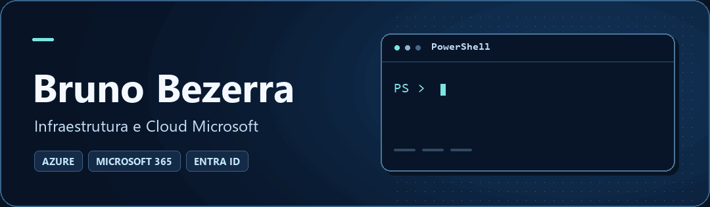

<picture>
  <source media="(prefers-reduced-motion: reduce)" srcset="./banner-static.png">
  
</picture>

  São Paulo, SP &nbsp;·&nbsp; Inglês C1 &nbsp;·&nbsp; Espanhol B2 &nbsp;·&nbsp;
  <a href="https://www.linkedin.com/in/bruno-bezerra-504838241/"><strong>LinkedIn ↗</strong></a>

## Sobre mim

Atuo com **infraestrutura de TI em ambientes Microsoft**, com foco em nuvem. Administro recursos no **Azure** e serviços do **Microsoft 365** e gerencio identidades e acessos no **Microsoft Entra ID** e no **Active Directory (AD DS)**.

Uso **PowerShell** para automatizar tarefas como provisionamento de contas, geração de relatórios de licenciamento e integrações com o Microsoft 365 e o Teams via **APIs REST e webhooks**. Versiono scripts e documentação com **Git** e uso o **Azure DevOps** para acompanhar o backlog e os fluxos de trabalho com as equipes de desenvolvimento.

Minha formação técnica em **C#, .NET e APIs REST** me ajuda a entender as aplicações que a infraestrutura sustenta e a trabalhar com as equipes de desenvolvimento. Hoje aplico essa base à automação e aprofundo meus conhecimentos em **infraestrutura como código e práticas de DevOps**. Uso inglês no atendimento a usuários e na leitura de documentação técnica.

**Em estudo:** AZ-104 (Azure Administrator), Linux e Terraform.

## O que faço na prática

- **Cloud Microsoft** · Administro recursos no Azure e serviços como Exchange Online, Teams e SharePoint no Microsoft 365.
- **Identidades e acessos** · Gerencio o ciclo de vida de contas, grupos e permissões no Microsoft Entra ID e no Active Directory (AD DS).
- **Automação** · Escrevo scripts PowerShell e integro rotinas do Microsoft 365 e do Teams via APIs REST e webhooks. Versiono scripts e documentação com Git e acompanho o backlog no Azure Boards.
- **Operações de TI** · Atuo na sustentação de ambientes corporativos e no diagnóstico de problemas com TCP/IP, DNS, DHCP e VPN. Trabalho com monitoramento no Zabbix, gestão de chamados no GLPI e inventário de ativos (ITAM).

## Formação

Curso **Análise e Desenvolvimento de Sistemas na UNICID** e concluí o técnico em **Desenvolvimento de Software Interativo na Etec Ferraz de Vasconcelos**. Minha base em C#, .NET e SQL me ajuda a entender as aplicações que a infraestrutura sustenta.
